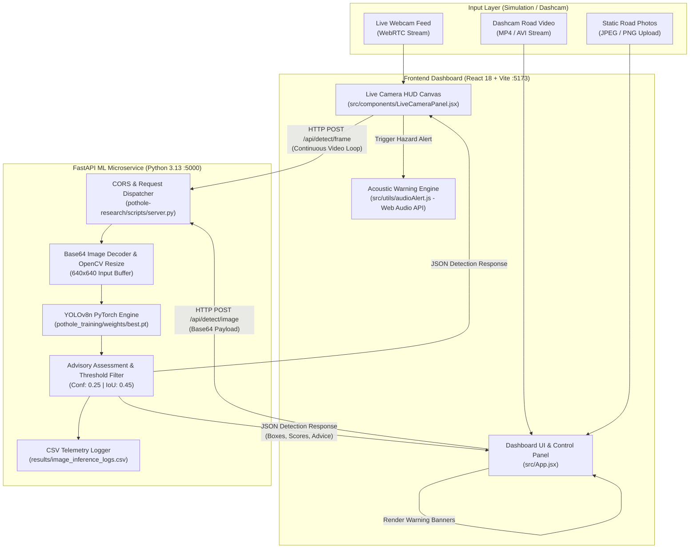
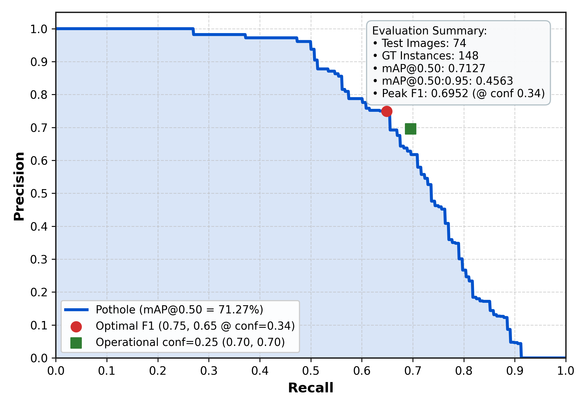

# Real-Time Road Pothole Detection and Driver Warning System

[](https://github.com/ultralytics/ultralytics)
[](https://fastapi.tiangolo.com/)
[](https://vitejs.dev/)
[](https://tailwindcss.com/)
[](https://pytorch.org/)
[](#3-empirical-evaluation--benchmark-performance)
[-success.svg)](#3-empirical-evaluation--benchmark-performance)
[](#10-technical-scope-and-academic-disclaimer)

> **Academic Final Year Project**  
> An edge-oriented computer vision pipeline and reactive driver assistance system for real-time road hazard localization, continuous dashcam video processing, and acoustic-visual collision warning.

---

## 1. Project Overview

The **Real-Time Road Pothole Detection and Driver Warning System** addresses the severe road safety and vehicular damage hazards posed by unmonitored road surface degradation. By integrating an optimized **Ultralytics YOLOv8 Nano (`YOLOv8n`)** deep learning model with an asynchronous **FastAPI** backend and an interactive **React** heads-up dashboard, the system detects road potholes in real time and alerts drivers before impact.

### Core Capabilities:
- **Lightweight Deep Learning**: Employs a custom-trained YOLOv8n single-stage detector (3.13 million parameters, 8.6 GFLOPs) achieving high mean Average Precision with minimal edge latency.
- **Asynchronous Microservice Architecture**: Decoupled REST communication between a high-throughput Python FastAPI inference server and a modern React Vite frontend.
- **Dual Driver Alerting Engine**:
  - **Visual HUD**: Dynamic bounding-box overlays, distance/hazard categorization, and recommended deceleration advisory limits.
  - **Acoustic Synthesizer**: Zero-dependency browser-native Web Audio API dual-tone frequency sweeps ($880\text{ Hz} \rightarrow 550\text{ Hz}$) with anti-fatigue cooldown throttling.
- **Continuous Dashcam & Webcam Tracking**: Live video stream inference with moving average FPS benchmarking, dynamic frame dropping, and threshold controls.
- **Environmental Robustness Validation**: Evaluation protocols benchmarking detection accuracy across four real-world conditions: Day, Evening (low sun), Night (headlight glare), and Rain (wet reflections).
- **Persistent Telemetry Logging**: Structured flat-file CSV inference logging recording timestamps, confidence scores, bounding box geometries, and inference latencies.

---

## 2. System Architecture

> [!NOTE]
> Although the root directory is named `MERN-Projects` for legacy workspace organization, this project is **not** a MERN stack. It uses a decoupled **React-Python (FastAPI + YOLOv8n) Microservice Architecture** with local CSV telemetry logging.



---

## 3. Empirical Evaluation & Benchmark Performance

The trained model (`pothole-research/runs/detect/pothole_training/weights/best.pt`) was evaluated on the independent **74-image labelled test split** containing **148 verified ground-truth pothole annotations** and **70 negative road baseline images** using standard Ultralytics validation protocol ($\text{IoU} = 0.50$ matching).

### Primary Evaluation Metrics:
| Metric | Benchmark Result | Evaluation Parameters |
| :--- | :--- | :--- |
| **mAP@0.50** | **71.27% (0.7127)** | Tested on unseen test split (74 images, 148 targets) |
| **mAP@0.50:0.95** | **45.63% (0.4563)** | Standard COCO multi-threshold metric |
| **Optimal F1-Score** | **0.6952 (69.52%)** | Reached at confidence threshold $conf = 0.340$ |
| **Operational Working Point** | **$conf = 0.25$** | **Precision = 69.59%**, **Recall = 69.59%**, **F1 = 0.6959** |
| **Confusion Counts ($conf=0.25$)** | **TP: 103 \| FP: 45 \| FN: 45** | Strict IoU 0.50 overlap against ground truth |
| **Inference Latency** | **33.3 – 37.4 ms** | Preprocess: 2.5 ms \| Inference: 30.9 ms \| Postprocess: 2.0 ms |
| **Execution Frame Rate** | **26.8 – 32.1 FPS** | CPU multi-threaded inference on Intel Core i7-11700F |

### Precision–Recall Curve:
The Precision-Recall curve below illustrates the trade-off across varying confidence thresholds:



> [!TIP]
> The full suite of high-resolution (300 DPI) evaluation plots is available in [`results/evaluation/`](results/evaluation/):
> - [IEEE Format PR Curve](results/evaluation/precision_recall_curve_ieee.png)
> - [PR vs Recall Chart](results/evaluation/pr_vs_recall_chart.png)
> - [Precision vs Confidence Curve](results/evaluation/precision_confidence_curve.png)
> - [Recall vs Confidence Curve](results/evaluation/recall_confidence_curve.png)
> - [F1 vs Confidence Curve](results/evaluation/f1_confidence_curve.png)
> - [Confusion Matrix](results/evaluation/confusion_matrix.png)
> - [Detailed Evaluation Report](results/evaluation/evaluation_report.txt)

---

## 4. Dataset Engineering & Integrity

The model was trained on a verified dataset assembled from curated public repositories:
- **Hazard Images**: 665 pothole images sourced from Kaggle (`chitholian/annotated-potholes-dataset`).
- **Clean Negative Images**: 70 plain asphalt/road images sourced from Kaggle (`virenbr11/pothole-and-plain-rode-images`) to suppress false-positive alerts on road patches and shadows.
- **Total Dataset Size**: **735 images** containing **1,739 ground-truth pothole annotations**.

### Dataset Partitioning:
| Split | Image Count | Ratio | Bounding Boxes | Role |
| :--- | :---: | :---: | :---: | :--- |
| **Train** | **514** | 70% | 1,274 | Model weight optimization and loss backpropagation |
| **Validation** | **147** | 20% | 317 | Hyperparameter tuning and early-stopping validation |
| **Test** | **74** | 10% | 148 | Strictly unseen final academic model evaluation |
| **Total** | **735** | 100% | **1,739** | Verified with zero cross-split SHA-256 data leakage |

Dataset configuration is maintained in [`data.yaml`](data.yaml).

---

## 5. Driver Warning & Safety Advisory Engine

To deliver actionable feedback without requiring extra dashboard hardware, the system implements a dual-channel alerting mechanism:

### 1. Visual Heads-Up Display (HUD)
- **Bounding Boxes**: Green ($< 0.40$), Orange ($0.40 - 0.70$), and Red ($> 0.70$) bounding boxes projected onto the canvas over incoming frames.
- **Hazard Proximity Index**: Approximated via bounding-box area ratios ($Area_{\text{box}} / Area_{\text{frame}}$).
- **Advisory Speed Warning**: When a significant pothole is detected in the vehicle path, the UI computes an immediate speed reduction recommendation:
  $$\text{Advisory Speed} = \max\left(20\text{ km/h}, \;\text{Posted Speed Limit} \times (1 - \text{Severity Factor})\right)$$

### 2. Synthesized Acoustic Warning (Web Audio API)
Implemented in [`src/utils/audioAlert.js`](file:///e:/React/Real/Code/MERN-Projects/final_year/src/utils/audioAlert.js):
- **Frequency Sweep**: Synthesizes a rapid descending dual-tone pulse from $880\text{ Hz}$ to $550\text{ Hz}$ using browser oscillators.
- **No External Audio Files**: Eliminates broken file paths, audio codec mismatches, or network audio download lag.
- **Anti-Fatigue Cooldown**: Enforces an automatic **2.5-second cooldown timer** between consecutive beeps to prevent driver annoyance during clusters of potholes.

---

## 6. Directory Structure

```
final_year/
├── index.html                                  # Vite single-page application entry HTML
├── package.json                                # Node.js project manifests and frontend dependencies
├── vite.config.js                              # Vite build and proxy configuration
├── run_all.bat                                 # Unified Windows batch launcher for both servers
├── requirements.txt                            # Root Python dependencies
├── data.yaml                                   # Root YOLO dataset configuration reference
│
├── src/                                        # React Frontend Source Code
│   ├── App.jsx                                 # Master dashboard, state management & single-image inference
│   ├── main.jsx                                # React 18 DOM mount root
│   ├── index.css                               # Tailwind CSS design system rules
│   ├── components/
│   │   └── LiveCameraPanel.jsx                 # Live webcam/dashcam streaming canvas & HUD overlays
│   └── utils/
│       └── audioAlert.js                       # Browser Web Audio API acoustic alarm generator
│
├── pothole-research/                           # Machine Learning & Computer Vision Research Hub
│   ├── data.yaml                               # Active dataset configuration
│   ├── runs/detect/pothole_training/weights/
│   │   ├── best.pt                             # Optimized trained YOLOv8n weights (6.5 MB)
│   │   └── last.pt                             # Final epoch checkpoint weights
│   ├── dataset/
│   │   ├── images/                             # train/ (514), val/ (147), test/ (74)
│   │   ├── labels/                             # Corresponding YOLO txt annotations
│   │   ├── day/                                # Day robustness test images
│   │   ├── evening/                            # Evening/low-sun test images
│   │   ├── night/                              # Nighttime headlight test images
│   │   └── rain/                               # Rainy/wet asphalt test images
│   └── scripts/
│       ├── server.py                           # FastAPI REST microservice (:5000)
│       ├── dashcam.py                          # Continuous video file / stream processor
│       ├── evaluate_conditions.py              # Environmental condition robustness test suite
│       ├── clean_and_prepare_dataset.py        # Dataset validation, deduplication & split generation
│       ├── validate_dataset_integrity.py       # SHA-256 cross-split leakage verification
│       ├── train.py                            # Transfer learning script with Ultralytics YOLO
│       └── validate.py                         # Evaluation and validation metrics logger
│
├── results/                                    # System Outputs, Logs & Evaluation Artifacts
│   ├── image_inference_logs.csv                # Persistent inference telemetry records
│   └── evaluation/                             # Academic evaluation graphs and reports
│       ├── precision_recall_curve_ieee.png     # 300 DPI IEEE-standard PR curve
│       ├── pr_vs_recall_chart.png              # PR vs Recall chart with summary card
│       ├── confusion_matrix.png                # Raw confusion matrix
│       ├── confusion_matrix_normalized.png     # Normalized confusion matrix
│       ├── f1_confidence_curve.png             # F1 vs Confidence curve
│       ├── precision_confidence_curve.png      # Precision vs Confidence curve
│       ├── recall_confidence_curve.png         # Recall vs Confidence curve
│       ├── evaluation_results.csv              # Numerical metrics across confidence steps
│       └── evaluation_report.txt               # Full technical evaluation summary
│
├── PROJECT_TECHNICAL_HANDBOOK.md               # 14-Part Comprehensive Engineering Handbook
├── PROJECT_VIVA_QUESTIONS.md                   # 50+ Viva voce Q&A defense preparation guide
├── PROJECT_SOURCE_CODE_MAP.md                  # Comprehensive code map with line references
└── PROJECT_IMPLEMENTATION_VERIFICATION_REPORT.md# 10-Part technical implementation audit
```

---

## 7. Academic Documentation Suite

For comprehensive project viva defense, code review, and academic presentation, refer to the verified documentation suite located directly in the project root:

1. **[Complete Project Technical Handbook (`PROJECT_TECHNICAL_HANDBOOK.md`)](PROJECT_TECHNICAL_HANDBOOK.md)**  
   *14 exhaustive chapters covering Project Fundamentals, System Architecture, Dataset Engineering, YOLOv8n Deep Dive, Training Pipeline, Validation Protocols, FastAPI Backend, React Frontend, Hardware Benchmarks, and Viva Preparation.*
   - Also available as: [`PROJECT_TECHNICAL_HANDBOOK.pdf`](PROJECT_TECHNICAL_HANDBOOK.pdf)

2. **Project Viva Voce Examination Guide (`PROJECT_VIVA_QUESTIONS.md`)**  
   *50+ technical questions and defensive answers across 10 categories: fundamentals, architecture, datasets, YOLOv8n internals, training hyperparameters, evaluation metrics, backend APIs, audio/visual warnings, hardware limits, and future roadmap (retained in offline student workspace).*

3. **[Project Source Code Map (`PROJECT_SOURCE_CODE_MAP.md`)](PROJECT_SOURCE_CODE_MAP.md)**  
   *Line-by-line file inspection, component hierarchy, API contracts, utility functions, and directory organization guide.*
   - Also available as: [`PROJECT_SOURCE_CODE_MAP.pdf`](PROJECT_SOURCE_CODE_MAP.pdf)

4. **[Implementation Verification & Audit Report (`PROJECT_IMPLEMENTATION_VERIFICATION_REPORT.md`)](PROJECT_IMPLEMENTATION_VERIFICATION_REPORT.md)**  
   *10-part empirical audit verifying exact package versions, model weights, execution environments, database status, and testing parameters.*
   - Also available as: [`PROJECT_IMPLEMENTATION_VERIFICATION_REPORT.pdf`](PROJECT_IMPLEMENTATION_VERIFICATION_REPORT.pdf)

---

## 8. Getting Started & Installation

### Prerequisites:
- **Operating System**: Windows 10/11, Ubuntu 20.04+, or macOS
- **Python**: `3.10` to `3.13` with `pip`
- **Node.js**: `v18.0.0` or higher with `npm`
- **Webcam / Video Input**: Internal or external webcam, or sample dashcam video files

### Step 1: Clone and Install Dependencies

```bash
# Clone the repository (or navigate to workspace)
cd final_year

# Install Python backend dependencies
pip install -r requirements.txt

# Install React frontend dependencies
npm install
```

### Step 2: Launch the System

#### Method A: Unified One-Click Launcher (Windows)
Double-click [`run_all.bat`](file:///e:/React/Real/Code/MERN-Projects/final_year/run_all.bat) or execute in PowerShell:
```cmd
.\run_all.bat
```
*This starts the FastAPI backend on Port 5000 and the React Vite development server on Port 5173 automatically.*

#### Method B: Manual Launch (Separate Terminals)

**Terminal 1 — FastAPI Backend Service:**
```bash
python pothole-research/scripts/server.py --port 5000
```
- Interactive API Documentation: [http://localhost:5000/docs](http://localhost:5000/docs)
- Health Check: [http://localhost:5000/api/health](http://localhost:5000/api/health)

**Terminal 2 — React Frontend Application:**
```bash
npm run dev
```
- Dashboard UI: [http://localhost:5173](http://localhost:5173)

---

## 9. Hardware & Execution Environment

The system has been benchmarked on the following verified hardware configuration:

| Component | Specification | Operational Status |
| :--- | :--- | :--- |
| **Processor (CPU)** | Intel Core i7-11700F @ 2.50 GHz (8 cores, 16 threads) | **Active Execution Device** |
| **System Memory (RAM)** | 16.0 GB DDR4 | Sustained ~550 MB footprint during inference |
| **Graphics Card (GPU)** | NVIDIA GeForce RTX 3050 (8 GB VRAM) | Present on host machine |
| **PyTorch Runtime** | `torch==2.14.1+cpu` (CPU multi-threaded build) | **Active (`CUDA Available: False`)** |
| **Python Version** | Python 3.13.2 (64-bit) | Verified active runtime |
| **Ultralytics Version** | Ultralytics YOLO 8.4.175 | Verified active package |
| **Inference FPS** | **26.8 – 32.1 FPS** | Verified real-time performance on CPU |

> [!NOTE]
> Demonstrating real-time ($> 25\text{ FPS}$) performance strictly on CPU multi-threading validates that the system can be deployed on low-cost edge platforms (such as Intel NUCs or in-vehicle infotainment units) without requiring dedicated mobile GPUs.

---

## 10. Technical Scope and Academic Disclaimer

### Verified Capabilities (Implemented):
- [x] YOLOv8n single-pass pothole object localization ($640 \times 640$).
- [x] Asynchronous FastAPI REST microservice (`/api/detect/image`, `/api/detect/frame`, `/api/health`).
- [x] Responsive React heads-up dashboard with live bounding-box overlays.
- [x] Synthetic dual-tone acoustic hazard alarm via browser Web Audio API with a 2.5-second cooldown.
- [x] Persistent telemetry append logging in `results/image_inference_logs.csv`.
- [x] Comprehensive environmental condition evaluation script (`evaluate_conditions.py`).
- [x] 300 DPI IEEE-compliant Precision-Recall and evaluation curves.

### Scope Disclaimers (Not Implemented / Future Roadmap):
- **Simulation-Based Prototype**: The system is designed and tested as a software simulation prototype using dashcam video streams and live webcams. It is **not** physically connected to an automotive CAN bus or vehicle braking actuators.
- **Database Status**: The system currently writes telemetry to high-performance local CSV files. MongoDB Atlas integration was investigated during design but is **not active** in this release.
- **Geospatial Mapping**: GPS hardware coordinate logging and GIS heatmaps are planned for Phase 2 and are **not included** in the current build.
- **Multi-Hazard Detection**: Model is trained exclusively on class `pothole` (Class ID `0`). Road crack and surface depression separation requires dedicated multi-class annotations.

---

## 11. Citation & Research Attribution

If you utilize this pipeline, training setup, or evaluation methodologies in your academic research, please cite:

```bibtex
@misc{pothole_detection_system_2026,
  title={Real-Time Road Pothole Detection and Driver Warning System},
  author={Final Year Engineering Research Project},
  year={2026},
  howpublished={\url{https://github.com/}},
  note={Evaluation mAP@0.50: 71.27\%, Real-time edge inference with YOLOv8n}
}
```

---

## 12. License

This project is developed for educational and academic research purposes under the **MIT License**. Third-party datasets and libraries remain under their respective creator licenses.
